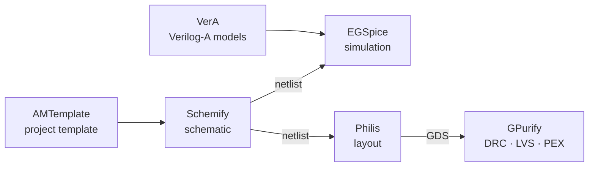
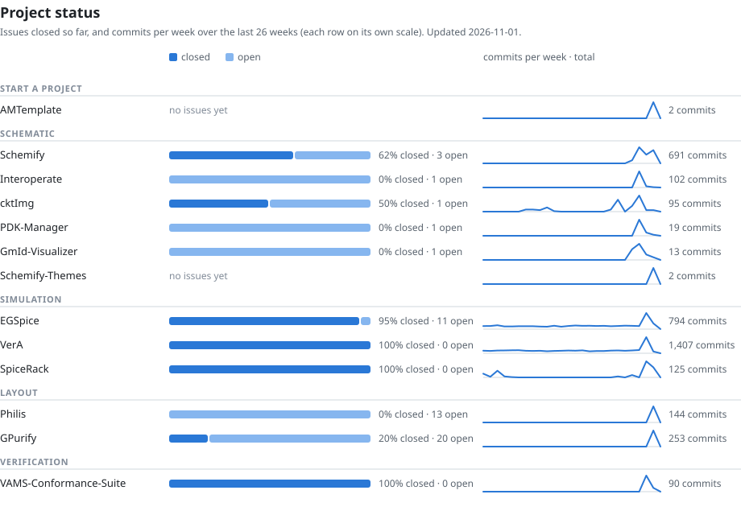

Open-source Fast Analog Tooling (Open-FAT) for analog and mixed-signal IC design, from schematic to sign-off, trying to automate as much as possible, while giving you full controls over every tool with plugins.

OpenFAT covers the steps of an analog design one tool at a time:
- schematic capture in **Schemify**
- SPICE simulation in **EGSpice**, with device models written in Verilog-A and compiled by **VerA**
- layout from a netlist in **Philis**
- DRC, LVS, ERC and PEX in **GPurify**

Each tool also works on its own beside the tools you already use. Schemify writes netlists for ngspice, Xyce, LTspice and HSPICE, and its Interoperate plugin moves designs to and from Cadence Virtuoso and xschem.



## Try it

These commands need [Nix](https://nixos.org/download/) or a Linux or macOS shell:

```sh
# Draw: open a cell in the schematic editor
nix run 'github:OpenFAT/Schemify#latest' -- path/to/cell.shcomp

# Simulate a SPICE deck (built from source), or install the release binary
nix run github:OpenFAT/EGSpice -- deck.sp
curl -fsSL https://raw.githubusercontent.com/OpenFAT/EGSpice/main/tools/install.sh | sh
```

To start a whole chip or block, create a repository from [AMTemplate](https://github.com/OpenFAT/AMTemplate) (**Use this template**), then run `make -C .flows CreateProject PROJECT_NAME=my_chip PROJECT_TYPE=mixed`.

## Projects

These tools are young and move quickly. The chart shows how much of each project's tracked work is done and how active it has been lately. A daily job updates it.

<!-- status:start -->
<picture>
  <source media="(prefers-color-scheme: dark)" srcset="status-dark.svg">
  
</picture>

| Stage | Project | What it does | Status |
|---|---|---|---|
| Start a project | [AMTemplate](https://github.com/OpenFAT/AMTemplate) | Template for analog and mixed-signal ASIC design on open-source tools | [](https://github.com/OpenFAT/AMTemplate/actions/workflows/ci.yaml)  |
| Schematic | [Schemify](https://github.com/OpenFAT/Schemify) | Schematic Editor, made to be lightweight and plugin-friendly just like vim and vim-plug | [](https://github.com/OpenFAT/Schemify/actions/workflows/ci.yml) [](https://github.com/OpenFAT/Schemify/releases/latest)  |
| Schematic | [Interoperate](https://github.com/OpenFAT/Interoperate) | Schemify's Import/Export working with other Schematic Editors so you can use it interchangeably | [](https://github.com/OpenFAT/Interoperate/actions/workflows/ci.yml)  |
| Schematic | [cktImg](https://github.com/OpenFAT/cktImg) | A netlist -> Img tool, agnostic backend (latex, C-ABI) | [](https://github.com/OpenFAT/cktImg/actions/workflows/ci.yml) [](https://github.com/OpenFAT/cktImg/releases/latest)  |
| Schematic | [PDK-Manager](https://github.com/OpenFAT/PDK-Manager) | Interface to allow easy usage of PDKs (open-source and propietary over ssh) | [](https://github.com/OpenFAT/PDK-Manager/actions/workflows/ci.yml)  |
| Schematic | [GmId-Visualizer](https://github.com/OpenFAT/GmId-Visualizer) | A Gm/Id visualizer written in C++ | [](https://github.com/OpenFAT/GmId-Visualizer/actions/workflows/ci.yml)  |
| Schematic | [Schemify-Themes](https://github.com/OpenFAT/Schemify-Themes) | spicetify's theme catalogue for Schemify: 16 themes, 115 colour schemes, View → Themes | [](https://github.com/OpenFAT/Schemify-Themes/actions/workflows/gate.yaml)  |
| Simulation | [EGSpice](https://github.com/OpenFAT/EGSpice) | Fast Spice Simulations, with Verilog-AMS support using VerA | [](https://github.com/OpenFAT/EGSpice/actions/workflows/test.yml)  |
| Simulation | [VerA](https://github.com/OpenFAT/VerA) | A Verilog-AMS Compiler with SIMD and GPU support as first-class residents | [](https://github.com/OpenFAT/VerA/actions/workflows/test.yaml) [](https://github.com/OpenFAT/VerA/releases/latest)  |
| Simulation | [SpiceRack](https://github.com/OpenFAT/SpiceRack) | A Spice Interface in Python that has universal syntax, emits any SPICE backend of the user's choice | [](https://github.com/OpenFAT/SpiceRack/actions/workflows/test.yaml)  |
| Layout | [Philis](https://github.com/OpenFAT/Philis) | Automated ANalog P&R Engine that doesn't use ML | [](https://github.com/OpenFAT/Philis/actions/workflows/ci.yml)  |
| Layout | [GPurify](https://github.com/OpenFAT/GPurify) | A SIMD-First DRC, ERC, LVS, PEX engine, built for better checks than propietary work | [](https://github.com/OpenFAT/GPurify/actions/workflows/test.yml)  |
| Verification | [VAMS-Conformance-Suite](https://github.com/OpenFAT/VAMS-Conformance-Suite) | A conformance suite for Verilog-AMS (Containing Verilog-A & IEEE 1364 specifics) | [](https://github.com/OpenFAT/VAMS-Conformance-Suite/actions/workflows/conformance.yml)  |
<!-- status:end -->
